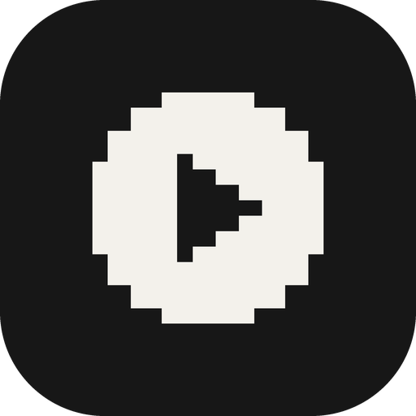

# Resonance

[English](README.md) · [简体中文](README.zh-CN.md) · [繁體中文](README.zh-TW.md) ·
[日本語](README.ja.md) · [한국어](README.ko.md) · [Español](README.es.md)

Reproductor Android offline con importación local, cola, capítulos, posiciones de reanudación por
archivo y forma de onda en directo. Requiere Android10+, incluye UI inglesa y chino
tradicional/simplificado con temas claro/oscuro/sistema, sin cuenta.

## Importar y descargar

Use el selector Android: guarda copias en almacenamiento privado. Los archivos locales existentes
funcionan offline; los codecs dependen del dispositivo. No incluye colección privada ni portadas
ajenas. La estantería LAN opcional transmite o copia sus archivos desde un ordenador.

La publicación es [v0.9.1](https://github.com/codingEzio/Resonance/releases/tag/v0.9.1), APK
firmado, SHA256SUMS y huella pública de certificado. Autorice la instalación desde navegador/gestor
cuando corresponda y verifique con [RELEASE.md](RELEASE.md). El candidato actual0.9.2/code11 es
inédito y sin firma: sus comprobaciones no son aceptación física o de publicación. F-Droid constaba
pendiente en0.9.1; su disponibilidad actual no se ha comprobado aquí.

## Construir

Instale JDK17 libre, Android SDK37 y build tools36.0.0; configure ANDROID_HOME.
`./gradlew -Presonance.profile=portable :app:assembleRelease` produce APK sin firma. Gradle descarga
dependencias de Google Maven/Maven Central. No necesita cuenta, ajustes personales, clave de firma o
medios privados.

Los APK GitHub usan la clave release retenida. La propuesta F-Droid de reconstruir con la misma
firma exige aceptación y comprobación reproducible aparte. `./gradlew :app:assembleDebug` añade
.catalog. ID público: io.github.codingezio.resonance, distinto del desarrollo privado. No importa
automáticamente datos privados de otra App.

## Estantería LAN opcional

Instale Deno, ffprobe y shasum. Copie server/config.example.json a <private-data>/config.json y
elija raíces absolutas de biblioteca. Arranque `deno task serve`, abra localhost:12345 en el
servidor y empareje Android con su información de conexión. Por defecto no sirve archivos y no
arranca solo. Sólo expone raíces seleccionadas; HTTP no está cifrado, por lo que debe usar una LAN
de confianza. La importación local y reproducción offline Android no necesitan la estantería.

server/config.json contiene defaults; RESONANCE_CONFIG elige overlay y RESONANCE_BIND/RESONANCE_PORT
prevalecen para dirección/puerto. El estado vive en el directorio privado seleccionado; manténgalo
privado y respáldelo aparte. La App Mac privada y su biblioteca quedan fuera del código público.

## Perfil privado de datos

`<private-data>` usa por defecto `~/Library/Application Support/ResonanceShelf` en macOS, XDG en
Linux y Local AppData en Windows. Esta revisión sólo verificó el Mac actual y fixtures aislados.
RESONANCE_DATA exige un directorio absoluto fuera del checkout. Su config.json es el overlay
predeterminado; RESONANCE_CONFIG cambia el archivo de ajustes sin mover el perfil. stateDirectory
punto usa ese perfil; las rutas relativas parten de él. Rechaza recorridos de padres y enlaces
físicos hacia el código.

Para otro perfil, configure `RESONANCE_DATA=/path/to/private-shelf-data`, cree el directorio, copie
server/config.example.json como config.json y seleccione sus raíces. No lo añada a Git y respáldelo
aparte. Cambiar la ruta no migra datos.

Si quedan Local/shelf o Local/portable-shelf, el inicio normal falla. Detenga su propia estantería,
preserve ajustes, copie config.json/access-key/catalog.json sin sobrescribir otro perfil, cambie
stateDirectory a punto y verifique hashes de clave/catálogo y los demás ajustes. Conserve originales
privados fuera del código antes de reiniciar. Un RESONANCE_DATA nuevo explícito elige otro perfil.
Las pruebas del candidato no usan datos personales.

## Privacidad y licencia

Medios, progreso, cola, ajustes y wishlist quedan locales. No hay SDK de anuncios/analytics. Sólo
conexiones LAN elegidas envían emparejamiento, metadatos y archivos solicitados. Android cloud
backup está desactivado; desinstalar elimina datos privados.

Código y arte original de App usan [GPL-3.0-or-later](LICENSE); fuentes y terceros conservan
términos. Consulte [PRIVACY.md](PRIVACY.md), [DEPENDENCIES.md](DEPENDENCIES.md),
[QUALITY.md](QUALITY.md). Aporte medios con derecho de uso. Capturas/pruebas0.9.1 son históricas, no
aceptación0.9.2 de dispositivo, rendimiento, firma o F-Droid. Esta preparación no instala, inicia la
estantería ni accede a dispositivos/medios.
